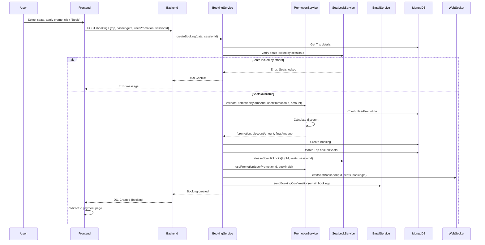
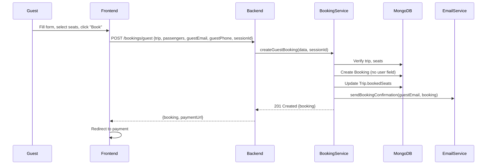
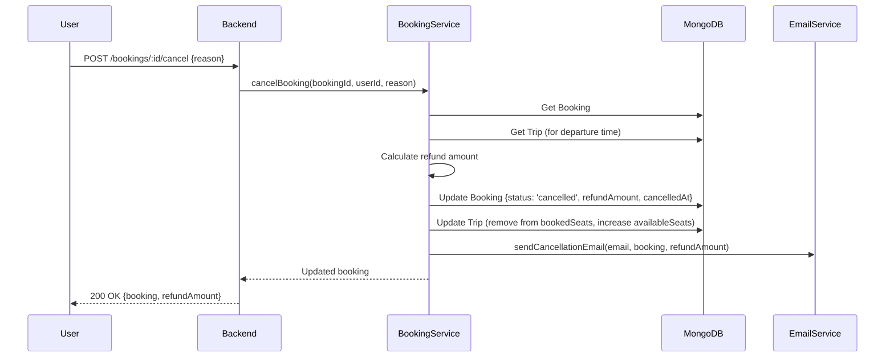

# Bookings API - Tài Liệu Kỹ Thuật Chi Tiết

## 📋 Tổng Quan

Bookings API quản lý toàn bộ flow đặt vé: tạo booking, thanh toán, quản lý trạng thái, hủy vé, và hoàn tiền.

### 🎯 Features

- **User Booking** - Đặt vé cho user đã đăng nhập
- **Guest Booking** - Đặt vé không cần đăng nhập
- **Payment Integration** - Tích hợp PayOS, MoMo, ZaloPay
- **Promotion Support** - Áp dụng mã giảm giá
- **Email Notifications** - Gửi email xác nhận, hủy vé
- **Refund Calculation** - Tính toán hoàn tiền theo chính sách
- **Status Management** - Quản lý lifecycle booking

---

## 🏗️ Kiến Trúc

### Files Liên Quan

```
src/
├── routes/v1/
│   └── booking.route.ts             # Booking routes
├── controllers/
│   └── booking.controller.ts        # Controllers
├── services/
│   ├── booking.service.ts           # Core booking logic
│   ├── promotion.service.ts         # Apply promotion
│   ├── email.service.ts             # Send notifications
│   └── seatlock.service.ts          # Release locks after booking
├── models/
│   └── booking.model.ts             # Booking schema
└── validations/
    └── booking.validation.ts        # Validation rules
```

---

## 📊 Data Model

### Booking Schema

```typescript
{
  // References
  user?: ObjectId;                   // User (if authenticated)
  trip: ObjectId;                    // Trip reference

  // Booking Info
  referenceNumber: string;           // "BKG-1735812345-ABC123"
  totalPassengers: number;           // Number of passengers
  passengers: [
    {
      name: string;                  // "Nguyen Van A"
      age: number;                   // 25
      gender: 'male' | 'female' | 'other';
      identityNumber?: string;       // ID/Passport
      seatNumber: string;            // "A3"
      seatPrice: number;             // 250000 (per seat)
    }
  ],

  // Pricing
  totalAmount: number;               // Final amount after discount
  originalAmount?: number;           // Before discount
  discountAmount?: number;           // Discount applied

  // Promotion
  appliedPromotion?: ObjectId;       // Promotion reference
  userPromotion?: ObjectId;          // UserPromotion reference

  // Payment
  payment: {
    method: 'payos' | 'momo' | 'zalopay' | 'cash';
    status: 'pending' | 'completed' | 'failed' | 'refunded';
    amount: number;
    currency: string;                // "VND"
    transactionId?: string;          // Payment gateway transaction ID
    paidAt?: Date;
  },

  // Status
  status: 'pending' | 'confirmed' | 'cancelled' | 'completed';

  // Guest Info (for guest bookings)
  guestEmail?: string;
  guestPhone?: string;
  contactEmail?: string;
  contactPhone?: string;

  // Cancellation
  cancelledAt?: Date;
  cancellationReason?: string;
  refundAmount?: number;
  refundStatus?: 'pending' | 'completed' | 'rejected';

  // Timestamps
  createdAt: Date;
  updatedAt: Date;
}
```

---

## 📡 API Endpoints

### 1️⃣ **Create Booking (Authenticated User)**

**Endpoint:**

```
POST /v1/bookings
```

**Authentication:** ✅ Required

**Request Body:**

```json
{
  "trip": "675d1234567890abcdef1234",
  "passengers": [
    {
      "name": "Nguyen Van A",
      "age": 25,
      "gender": "male",
      "identityNumber": "001234567890",
      "seatNumber": "A3"
    },
    {
      "name": "Nguyen Thi B",
      "age": 23,
      "gender": "female",
      "seatNumber": "A4"
    }
  ],
  "userPromotion": "675d...",
  "sessionId": "guest-123456",
  "paymentMethod": "payos"
}
```

**Validation:**

- ✅ Trip exists and available
- ✅ Seats locked by this session
- ✅ Seats not already booked
- ✅ Promotion valid (if provided)
- ✅ Passenger info complete

**Response:**

```json
{
  "_id": "675d...",
  "referenceNumber": "BKG-1735812345-ABC123",
  "user": "675d...",
  "trip": {
    "_id": "675d...",
    "departureTime": "2026-01-15T08:00:00.000Z",
    "route": {
      "origin": { "city": "Ho Chi Minh" },
      "destination": { "city": "Da Lat" }
    }
  },
  "passengers": [
    {
      "name": "Nguyen Van A",
      "seatNumber": "A3",
      "seatPrice": 250000
    },
    {
      "name": "Nguyen Thi B",
      "seatNumber": "A4",
      "seatPrice": 250000
    }
  ],
  "totalPassengers": 2,
  "originalAmount": 500000,
  "discountAmount": 100000,
  "totalAmount": 400000,
  "appliedPromotion": "675d...",
  "payment": {
    "method": "payos",
    "status": "pending",
    "amount": 400000,
    "currency": "VND"
  },
  "status": "pending",
  "createdAt": "2026-01-02T10:30:00.000Z"
}
```

---

### 2️⃣ **Create Guest Booking**

**Endpoint:**

```
POST /v1/bookings/guest
```

**Authentication:** ❌ Not required

**Request Body:**

```json
{
  "trip": "675d1234567890abcdef1234",
  "passengers": [
    {
      "name": "Nguyen Van A",
      "age": 25,
      "gender": "male",
      "seatNumber": "A3"
    }
  ],
  "guestEmail": "guest@example.com",
  "guestPhone": "+84901234567",
  "sessionId": "guest-123456",
  "paymentMethod": "payos"
}
```

**Response:** Similar to authenticated booking

**Differences:**

- No `user` field
- Required: `guestEmail`, `guestPhone`
- Cannot apply user promotions
- Confirmation email sent to `guestEmail`

---

### 3️⃣ **Get User Bookings**

**Endpoint:**

```
GET /v1/bookings
```

**Authentication:** ✅ Required (Admin or Own bookings)

**Query Parameters:**

| Parameter   | Type     | Required | Default     | Mô Tả                                                    |
| ----------- | -------- | -------- | ----------- | -------------------------------------------------------- |
| `status`    | `string` | ❌ No    | -           | Filter: `pending`, `confirmed`, `cancelled`, `completed` |
| `page`      | `number` | ❌ No    | `1`         | Page number                                              |
| `limit`     | `number` | ❌ No    | `10`        | Results per page                                         |
| `sortBy`    | `string` | ❌ No    | `createdAt` | Sort field                                               |
| `sortOrder` | `string` | ❌ No    | `desc`      | `asc` or `desc`                                          |

**Example Request:**

```bash
GET /v1/bookings?status=confirmed&page=1&limit=10
```

**Response:**

```json
{
  "results": [
    {
      "_id": "675d...",
      "referenceNumber": "BKG-1735812345-ABC123",
      "trip": {
        "departureTime": "2026-01-15T08:00:00.000Z",
        "route": {
          "origin": { "city": "Ho Chi Minh" },
          "destination": { "city": "Da Lat" }
        }
      },
      "totalPassengers": 2,
      "totalAmount": 400000,
      "status": "confirmed",
      "createdAt": "2026-01-02T10:30:00.000Z"
    }
    // ... more bookings
  ],
  "page": 1,
  "limit": 10,
  "totalPages": 3,
  "totalResults": 25
}
```

---

### 4️⃣ **Get Booking Details**

**Endpoint:**

```
GET /v1/bookings/:bookingId
```

**Authentication:** ✅ Required (Admin or Owner)

**Response:**

```json
{
  "_id": "675d...",
  "referenceNumber": "BKG-1735812345-ABC123",
  "user": {
    "_id": "675d...",
    "name": "Nguyen Van A",
    "email": "user@example.com"
  },
  "trip": {
    "_id": "675d...",
    "departureTime": "2026-01-15T08:00:00.000Z",
    "arrivalTime": "2026-01-15T14:00:00.000Z",
    "route": {
      "origin": {
        "city": "Ho Chi Minh",
        "province": "Ho Chi Minh"
      },
      "destination": {
        "city": "Da Lat",
        "province": "Lam Dong"
      }
    },
    "bus": {
      "busNumber": "51B-12345",
      "busType": "Limousine"
    }
  },
  "passengers": [
    {
      "name": "Nguyen Van A",
      "age": 25,
      "gender": "male",
      "seatNumber": "A3",
      "seatPrice": 250000
    },
    {
      "name": "Nguyen Thi B",
      "age": 23,
      "gender": "female",
      "seatNumber": "A4",
      "seatPrice": 250000
    }
  ],
  "totalPassengers": 2,
  "originalAmount": 500000,
  "discountAmount": 100000,
  "totalAmount": 400000,
  "appliedPromotion": {
    "code": "SUMMER2025",
    "title": "Summer Sale 50%"
  },
  "payment": {
    "method": "payos",
    "status": "completed",
    "amount": 400000,
    "currency": "VND",
    "transactionId": "PAY-1735812345",
    "paidAt": "2026-01-02T10:35:00.000Z"
  },
  "status": "confirmed",
  "createdAt": "2026-01-02T10:30:00.000Z",
  "updatedAt": "2026-01-02T10:35:00.000Z"
}
```

---

### 5️⃣ **Cancel Booking**

**Endpoint:**

```
POST /v1/bookings/:bookingId/cancel
```

**Authentication:** ✅ Required (Admin or Owner)

**Request Body:**

```json
{
  "reason": "Change of plans"
}
```

**Response:**

```json
{
  "_id": "675d...",
  "referenceNumber": "BKG-1735812345-ABC123",
  "status": "cancelled",
  "cancelledAt": "2026-01-03T09:00:00.000Z",
  "cancellationReason": "Change of plans",
  "refundAmount": 360000,
  "refundStatus": "pending",
  "message": "Booking cancelled successfully. Refund of 360,000 VND will be processed within 7-10 business days."
}
```

**Refund Policy:**

- **>24 hours before departure**: 90% refund
- **12-24 hours**: 70% refund
- **6-12 hours**: 50% refund
- **2-6 hours**: 25% refund
- **<2 hours**: No refund

---

### 6️⃣ **Update Booking (Admin)**

**Endpoint:**

```
PATCH /v1/bookings/:bookingId
```

**Authentication:** ✅ Required (Admin only)

**Request Body:**

```json
{
  "status": "confirmed",
  "payment": {
    "status": "completed",
    "transactionId": "PAY-1735812345",
    "paidAt": "2026-01-02T10:35:00.000Z"
  }
}
```

**Use Cases:**

- Confirm payment manually
- Update payment status
- Change booking status

---

## 🔄 Flow Hoạt Động

### Flow 1: User Booking với Promotion



---

### Flow 2: Guest Booking



---

### Flow 3: Cancel Booking với Refund



---

## 🧮 Calculation Logic

### Price Calculation

```typescript
// Calculate total from seat prices
const passengersWithPrice = passengers.map((p) => {
  // Use seat-specific pricing if available
  const seatPrice = trip.seatPricing?.get(p.seatNumber) || trip.pricePerSeat;
  return { ...p, seatPrice };
});

const calculatedTotal = passengersWithPrice.reduce((sum, p) => sum + p.seatPrice, 0);
```

### With Promotion

```typescript
let discountAmount = 0;
let finalAmount = calculatedTotal;

if (userPromotion) {
  const result = await promotionService.validatePromotionById(userId, userPromotionId, calculatedTotal);

  discountAmount = result.discountAmount;
  finalAmount = result.finalAmount;
}
```

### Refund Calculation

```typescript
const calculateRefund = (booking: IBooking, trip: ITrip): number => {
  if (!trip || !booking.totalAmount) return 0;

  const now = new Date();
  const departureTime = new Date(trip.departureTime);
  const hoursUntil = (departureTime.getTime() - now.getTime()) / (1000 * 60 * 60);

  if (hoursUntil > 24) {
    return booking.totalAmount * 0.9; // 90%
  } else if (hoursUntil > 12) {
    return booking.totalAmount * 0.7; // 70%
  } else if (hoursUntil > 6) {
    return booking.totalAmount * 0.5; // 50%
  } else if (hoursUntil > 2) {
    return booking.totalAmount * 0.25; // 25%
  }

  return 0; // No refund
};
```

---

## 📧 Email Notifications

### Booking Confirmation Email

**Trigger:** After successful booking creation

**Content:**

```
Subject: Booking Confirmation - BKG-1735812345-ABC123

Dear Nguyen Van A,

Your booking has been confirmed!

Booking Details:
- Reference: BKG-1735812345-ABC123
- Route: Ho Chi Minh → Da Lat
- Date: January 15, 2026 at 08:00 AM
- Bus: 51B-12345 (Limousine)
- Seats: A3, A4
- Total: 400,000 VND

Passengers:
1. Nguyen Van A - Seat A3
2. Nguyen Thi B - Seat A4

Payment: Pending
Please complete payment within 24 hours.

[Pay Now Button]

Thank you for choosing our service!
```

### Cancellation Email

**Trigger:** After booking cancellation

**Content:**

```
Subject: Booking Cancelled - BKG-1735812345-ABC123

Dear Nguyen Van A,

Your booking has been cancelled.

Cancellation Details:
- Reference: BKG-1735812345-ABC123
- Cancelled on: January 3, 2026
- Reason: Change of plans

Refund Information:
- Original Amount: 400,000 VND
- Refund Amount: 360,000 VND (90%)
- Refund Status: Pending
- Expected in: 7-10 business days

The refund will be processed to your original payment method.

If you have any questions, please contact support.
```

---

## 🛠️ Implementation Details

### Create Booking Service

```typescript
const createBooking = async (bookingBody: Partial<IBooking>, sessionId?: string): Promise<IBooking> => {
  // Step 1: Verify trip exists
  const trip = await Trip.findById(bookingBody.trip);
  if (!trip) {
    throw new ApiError(404, 'Trip not found');
  }

  const requestedSeats = bookingBody.passengers?.map((p) => p.seatNumber) || [];

  // Step 2: Verify seat locks
  const lockedSeats = await seatLockService.areSeatsLocked(trip._id, requestedSeats);
  if (lockedSeats && sessionId) {
    const ownsLock = await seatLockService.doesSessionOwnLock(trip._id, requestedSeats, sessionId);
    if (!ownsLock) {
      throw new ApiError(409, 'Seats locked by another user');
    }
  }

  // Step 3: Check if seats already booked
  const bookedSeats = requestedSeats.filter((seat) => trip.bookedSeats.includes(seat));
  if (bookedSeats.length > 0) {
    throw new ApiError(400, `Seats already booked: ${bookedSeats.join(', ')}`);
  }

  // Step 4: Calculate prices
  const passengersWithPrice = bookingBody.passengers?.map((p) => {
    const seatPrice = trip.seatPricing?.get(p.seatNumber) || trip.pricePerSeat;
    return { ...p, seatPrice };
  });

  const totalPassengers = passengersWithPrice?.length || 0;
  const calculatedTotal = passengersWithPrice?.reduce((sum, p) => sum + p.seatPrice, 0) || 0;

  // Step 5: Apply promotion
  let discountAmount = 0;
  let finalAmount = calculatedTotal;
  let promotionData: any = {};

  if (bookingBody.userPromotion && bookingBody.user) {
    try {
      const result = await promotionService.validatePromotionById(
        new mongoose.Types.ObjectId(bookingBody.user as any),
        new mongoose.Types.ObjectId(bookingBody.userPromotion as any),
        calculatedTotal
      );

      discountAmount = result.discountAmount;
      finalAmount = result.finalAmount;
      promotionData = {
        appliedPromotion: result.promotion._id,
        userPromotion: bookingBody.userPromotion,
        discountAmount,
        originalAmount: calculatedTotal,
      };
    } catch (error) {
      logger.warn(`Promotion validation failed: ${error.message}`);
    }
  }

  // Step 6: Generate reference number
  const referenceNumber = `BKG-${Date.now()}-${Math.random().toString(36).substring(7).toUpperCase()}`;

  // Step 7: Create booking
  const booking = await Booking.create({
    ...bookingBody,
    referenceNumber,
    passengers: passengersWithPrice,
    totalPassengers,
    totalAmount: finalAmount,
    ...promotionData,
    payment: {
      amount: finalAmount,
      currency: 'VND',
      status: 'pending',
      method: bookingBody.paymentMethod || 'payos',
    },
    status: 'pending',
  });

  // Step 8: Mark promotion as used
  if (promotionData.userPromotion && bookingBody.user) {
    await promotionService.usePromotion(
      new mongoose.Types.ObjectId(bookingBody.user as any),
      promotionData.userPromotion,
      booking._id
    );
  }

  // Step 9: Update trip
  trip.bookedSeats.push(...requestedSeats);
  trip.availableSeats -= requestedSeats.length;
  await trip.save();

  // Step 10: Release seat locks
  if (sessionId) {
    await seatLockService.releaseSpecificLocks(trip._id, requestedSeats, sessionId);
  }

  // Step 11: Emit WebSocket event
  emitSeatBooked(trip._id, requestedSeats, booking.referenceNumber);

  // Step 12: Send confirmation email
  await booking.populate([
    {
      path: 'trip',
      populate: ['route', 'bus', 'operator'],
    },
  ]);

  if (bookingBody.user) {
    const user = await User.findById(bookingBody.user);
    if (user?.email) {
      await emailService.sendBookingConfirmation(user.email, booking);
    }
  }

  return booking;
};
```

---

## 🧪 Testing Examples

### Test 1: Create Booking

```bash
curl -X POST "http://localhost:4000/v1/bookings" \
  -H "Authorization: Bearer <token>" \
  -H "Content-Type: application/json" \
  -d '{
    "trip": "675d1234567890abcdef1234",
    "passengers": [
      {
        "name": "Nguyen Van A",
        "age": 25,
        "gender": "male",
        "seatNumber": "A3"
      }
    ],
    "sessionId": "guest-123456",
    "paymentMethod": "payos"
  }'
```

### Test 2: Cancel Booking

```bash
curl -X POST "http://localhost:4000/v1/bookings/675d.../cancel" \
  -H "Authorization: Bearer <token>" \
  -H "Content-Type: application/json" \
  -d '{
    "reason": "Change of plans"
  }'
```

---

## ⚠️ Common Issues

### Issue 1: Booking Created But Payment Pending

**Solution:** Implement webhook to update payment status

```typescript
// PayOS webhook
app.post('/webhooks/payos', async (req, res) => {
  const { orderCode, status } = req.body;

  const booking = await Booking.findOne({
    'payment.transactionId': orderCode,
  });

  if (booking && status === 'PAID') {
    booking.payment.status = 'completed';
    booking.payment.paidAt = new Date();
    booking.status = 'confirmed';
    await booking.save();
  }
});
```

### Issue 2: Double Booking

**Cause:** Race condition between lock check and booking creation

**Fix:** Transaction with seat verification

```typescript
const session = await mongoose.startSession();
session.startTransaction();

try {
  // Re-verify seats within transaction
  const trip = await Trip.findById(tripId).session(session);
  const stillAvailable = requestedSeats.every((seat) => !trip.bookedSeats.includes(seat));

  if (!stillAvailable) {
    throw new ApiError(409, 'Seats no longer available');
  }

  // Create booking and update trip
  await Booking.create([bookingData], { session });
  trip.bookedSeats.push(...requestedSeats);
  await trip.save({ session });

  await session.commitTransaction();
} catch (error) {
  await session.abortTransaction();
  throw error;
} finally {
  session.endSession();
}
```

---

## 📚 API Reference Summary

| Endpoint                  | Method | Auth           | Purpose                      |
| ------------------------- | ------ | -------------- | ---------------------------- |
| `/v1/bookings`            | POST   | ✅ User        | Create authenticated booking |
| `/v1/bookings/guest`      | POST   | ❌ No          | Create guest booking         |
| `/v1/bookings`            | GET    | ✅ User/Admin  | List user's bookings         |
| `/v1/bookings/:id`        | GET    | ✅ Owner/Admin | Get booking details          |
| `/v1/bookings/:id`        | PATCH  | ✅ Admin       | Update booking               |
| `/v1/bookings/:id/cancel` | POST   | ✅ Owner/Admin | Cancel booking               |

---

## 📞 Support Files

**Tham khảo:**

- [`src/services/booking.service.ts`](../src/services/booking.service.ts) - Core booking logic
- [`src/services/email.service.ts`](../src/services/email.service.ts) - Email notifications
- [`src/models/booking.model.ts`](../src/models/booking.model.ts) - Booking schema
- [`docs/PAYOS_INTEGRATION_GUIDE.md`](./PAYOS_INTEGRATION_GUIDE.md) - Payment integration

---

**Last Updated:** January 2, 2026
**Version:** 1.0.0
