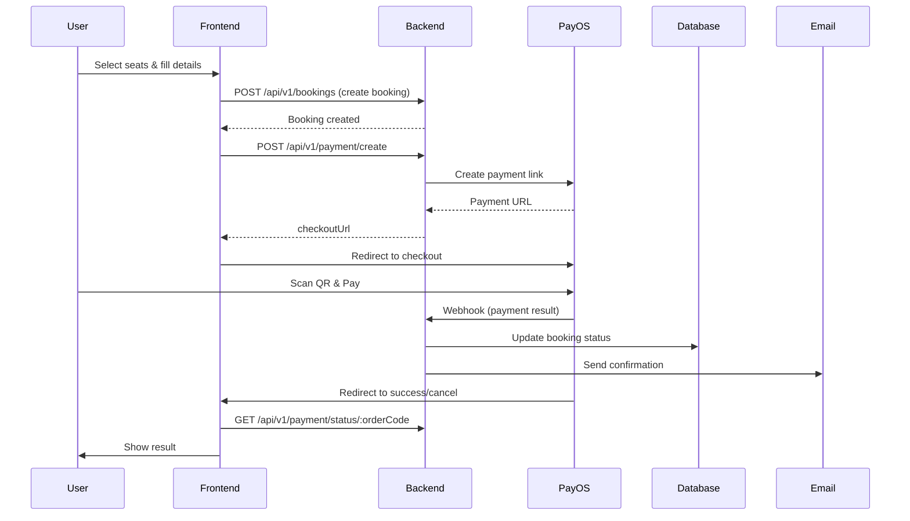

# PayOS Payment Flow - Quick Reference

## 🎯 Quick Start

### 1. Get PayOS Credentials

```
1. Sign up at https://payos.vn
2. Get: Client ID, API Key, Checksum Key
3. Add to backend/.env
```

### 2. Setup Environment

```env
# backend/.env
PAYOS_CLIENT_ID=your_client_id
PAYOS_API_KEY=your_api_key
PAYOS_CHECKSUM_KEY=your_checksum_key
FRONTEND_URL=http://localhost:3000
```

### 3. Configure Webhook (Production)

```
PayOS Dashboard → Webhooks
URL: https://api.yourdomain.com/api/v1/payment/webhook
```

## 🔄 Payment Flow



## 📝 Frontend Integration

### Checkout Page Flow

```typescript
// 1. User clicks "Complete Payment"
const handlePayment = async () => {
  // 2. Create booking
  const booking = await createBooking(bookingData);

  // 3. Get payment link
  const token = localStorage.getItem('accessToken');
  const payment = await createPaymentLink(booking.id, token);

  // 4. Redirect to PayOS
  window.location.href = payment.checkoutUrl;
};
```

### Success Page

```typescript
// URL: /payment/success?orderCode=123456
useEffect(() => {
  const checkStatus = async () => {
    const result = await checkPaymentStatus(orderCode, token);
    if (result.booking?.paymentStatus === 'completed') {
      // Show success message
    }
  };
  checkStatus();
}, [orderCode]);
```

## 🔗 Key Endpoints

| Endpoint                       | Method | Auth | Purpose              |
| ------------------------------ | ------ | ---- | -------------------- |
| `/api/v1/payment/create`       | POST   | ✅   | Create payment link  |
| `/api/v1/payment/webhook`      | POST   | ❌   | PayOS callback       |
| `/api/v1/payment/status/:code` | GET    | ✅   | Check payment status |
| `/api/v1/payment/cancel/:id`   | POST   | ✅   | Cancel payment       |

## 📂 File Structure

### Backend

```
backend/src/
├── config/config.ts              # PayOS config
├── services/payment.service.ts   # PayOS integration
├── controllers/payment.controller.ts
├── routes/v1/payment.route.ts
└── validations/payment.validation.ts
```

### Frontend

```
frontend/src/
├── lib/services/payment.service.ts  # API calls
├── app/
│   ├── checkout/page.tsx           # Payment initiation
│   └── payment/
│       ├── success/page.tsx        # Success handler
│       ├── cancel/page.tsx         # Cancel handler
│       └── processing/page.tsx     # Loading state
```

## ⚙️ Configuration Checklist

- [ ] PayOS credentials in `.env`
- [ ] Frontend URL configured
- [ ] Webhook URL registered (production only)
- [ ] HTTPS enabled (production)
- [ ] Test payment flow

## 🧪 Testing

```bash
# 1. Start backend
cd backend
npm run dev

# 2. Start frontend
cd frontend
npm run dev

# 3. Test flow
# - Go to http://localhost:3000
# - Search for trips
# - Select seats
# - Complete checkout
# - Test payment with small amount
```

## 🚨 Common Issues

### Webhook Not Received

- Check URL is public and HTTPS
- Verify in PayOS dashboard
- Check backend logs

### Payment Stuck

- Check orderCode in database
- Verify webhook signature
- Review backend error logs

### Redirect Not Working

- Check FRONTEND_URL in backend .env
- Verify returnUrl/cancelUrl format

## 📊 Payment Statuses

| Status | Code      | Meaning           |
| ------ | --------- | ----------------- |
| `00`   | Success   | Payment completed |
| `01`   | Cancelled | User cancelled    |
| `02`   | Failed    | Payment failed    |
| `03`   | Pending   | Processing        |

## 🔐 Security Notes

- ✅ Webhook signature verification enabled
- ✅ Token authentication required
- ✅ HTTPS required for production
- ✅ Environment variables protected
- ✅ Rate limiting configured

## 📞 Resources

- PayOS Docs: https://payos.vn/docs
- Full Guide: `backend/docs/PAYOS_INTEGRATION_GUIDE.md`
- PayOS Dashboard: https://my.payos.vn

---

**Version:** 1.0  
**Last Updated:** 2024-12-18
