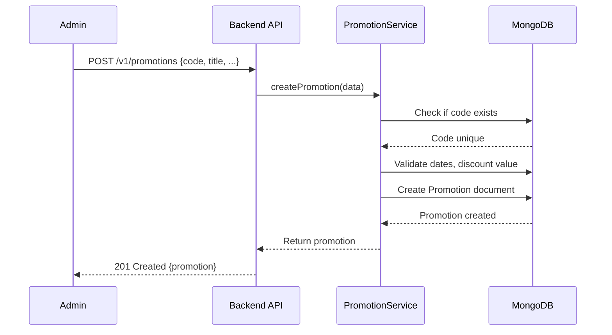
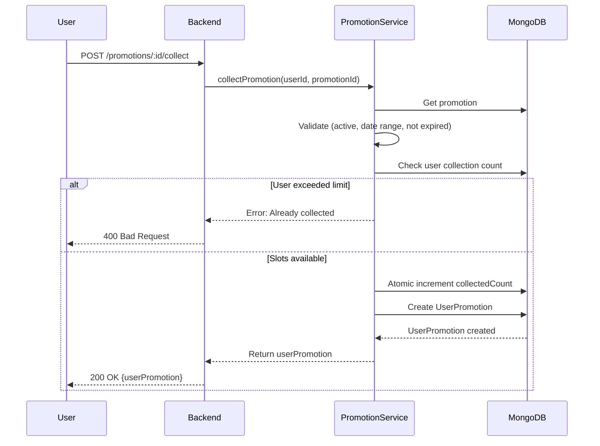
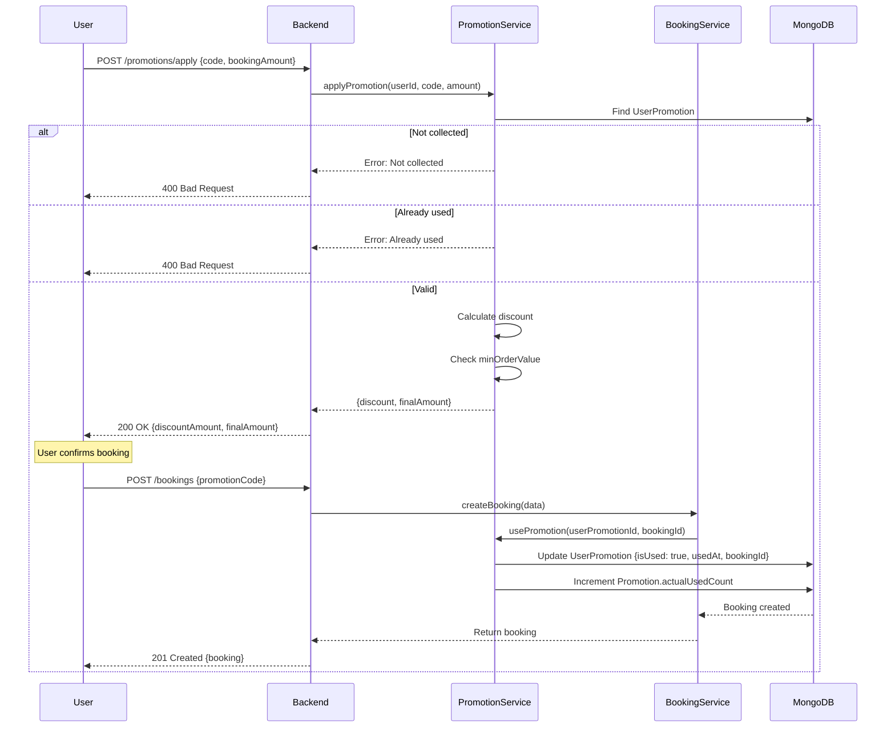

# Promotions API - Tài Liệu Kỹ Thuật Chi Tiết

## 📋 Tổng Quan

Promotions API quản lý mã giảm giá (vouchers/coupons) với đầy đủ lifecycle: tạo, phân phối, thu thập, áp dụng, và tracking sử dụng.

### 🎯 Features

- **Admin Management** - Tạo và quản lý promotions
- **User Collection** - User thu thập mã giảm giá
- **Validation** - Kiểm tra điều kiện áp dụng
- **Usage Tracking** - Theo dõi số lần sử dụng
- **Expiry Management** - Tự động expire promotions

---

## 🏗️ Kiến Trúc

### Files Liên Quan

```
src/
├── routes/v1/
│   └── promotion.route.ts           # Routes cho promotions
├── controllers/
│   └── promotion.controller.ts      # Controllers
├── services/
│   └── promotion.service.ts         # Business logic
├── models/
│   ├── promotion.model.ts           # Promotion schema
│   └── userpromotion.model.ts       # UserPromotion schema (collected)
├── validations/
│   └── promotion.validation.ts      # Validation rules
└── middlewares/
    └── auth.ts                       # Permission checking
```

---

## 📊 Data Models

### Promotion Model

```typescript
{
  code: string;                 // "SUMMER2025", "NEWYEAR50"
  title: string;                // "Summer Sale 50%"
  description: string;          // Detailed description
  discountType: 'fixed' | 'percentage';
  discountValue: number;        // 50000 (VND) or 50 (%)
  maxDiscount?: number;         // Max discount for percentage (e.g., 100000 VND)
  minOrderValue?: number;       // Min order to apply (e.g., 200000 VND)
  startDate: Date;              // "2026-01-01"
  endDate: Date;                // "2026-01-31"
  usageLimit: number;           // Total slots (e.g., 1000)
  collectedCount: number;       // How many users collected
  actualUsedCount: number;      // How many actually used in bookings
  perUserLimit: number;         // Max collections per user (default: 1)
  isActive: boolean;            // Admin can deactivate
  imageUrl?: string;            // Banner image
  terms?: string;               // Terms & conditions
  createdBy?: ObjectId;         // Admin who created
}
```

**Virtual Fields:**

- `isValid` - Check if currently valid (active, not expired, slots available)
- `isExpired` - Check if past endDate
- `remainingUsage` - Slots available = `usageLimit - collectedCount`
- `usageRate` - Actual usage rate = `actualUsedCount / collectedCount * 100`

---

### UserPromotion Model

```typescript
{
  userId: ObjectId;             // User who collected
  promotionId: ObjectId;        // Reference to Promotion
  collectedAt: Date;            // When user collected
  isUsed: boolean;              // Has been used in booking?
  isExpired: boolean;           // Past promotion endDate?
  usedAt?: Date;                // When used in booking
  bookingId?: ObjectId;         // Which booking used this
}
```

**Purpose:** Track individual user's promotion collection and usage

---

## 📡 API Endpoints

### 1️⃣ **Create Promotion (Admin)**

**Endpoint:**

```
POST /v1/promotions
```

**Authentication:** ✅ Required (Admin role)

**Request Body:**

```json
{
  "code": "SUMMER2025",
  "title": "Summer Sale 50%",
  "description": "Get 50% off on all trips this summer!",
  "discountType": "percentage",
  "discountValue": 50,
  "maxDiscount": 100000,
  "minOrderValue": 200000,
  "startDate": "2026-01-01T00:00:00.000Z",
  "endDate": "2026-01-31T23:59:59.999Z",
  "usageLimit": 1000,
  "perUserLimit": 1,
  "isActive": true,
  "imageUrl": "https://example.com/summer-banner.jpg",
  "terms": "Valid for all routes. Cannot be combined with other offers."
}
```

**Validation Rules:**

- `code`: Required, unique, uppercase, 3-20 characters
- `discountType`: `'fixed'` or `'percentage'`
- `discountValue`: > 0, if percentage then ≤ 100
- `startDate` < `endDate`
- `usageLimit`: >= 1
- `perUserLimit`: >= 1 (default: 1)

**Response:**

```json
{
  "_id": "675d1234567890abcdef1234",
  "code": "SUMMER2025",
  "title": "Summer Sale 50%",
  "discountType": "percentage",
  "discountValue": 50,
  "maxDiscount": 100000,
  "minOrderValue": 200000,
  "startDate": "2026-01-01T00:00:00.000Z",
  "endDate": "2026-01-31T23:59:59.999Z",
  "usageLimit": 1000,
  "collectedCount": 0,
  "actualUsedCount": 0,
  "perUserLimit": 1,
  "isActive": true,
  "createdBy": "675d...",
  "createdAt": "2026-01-02T10:00:00.000Z",
  "isValid": true,
  "isExpired": false,
  "remainingUsage": 1000
}
```

---

### 2️⃣ **Get Active Promotions (Public)**

**Endpoint:**

```
GET /v1/promotions/active
```

**Authentication:** ❌ Public

**Query Parameters:**

| Parameter | Type     | Required | Default | Mô Tả            |
| --------- | -------- | -------- | ------- | ---------------- |
| `page`    | `number` | ❌ No    | `1`     | Page number      |
| `limit`   | `number` | ❌ No    | `10`    | Results per page |

**Example Request:**

```bash
GET /v1/promotions/active?page=1&limit=10
```

**Response:**

```json
{
  "results": [
    {
      "_id": "675d...",
      "code": "SUMMER2025",
      "title": "Summer Sale 50%",
      "description": "Get 50% off on all trips!",
      "discountType": "percentage",
      "discountValue": 50,
      "maxDiscount": 100000,
      "minOrderValue": 200000,
      "startDate": "2026-01-01T00:00:00.000Z",
      "endDate": "2026-01-31T23:59:59.999Z",
      "imageUrl": "https://...",
      "terms": "...",
      "remainingUsage": 856
    }
    // ... more promotions
  ],
  "page": 1,
  "limit": 10,
  "totalPages": 2,
  "totalResults": 15
}
```

**Filter Logic:**

```typescript
{
  isActive: true,
  startDate: { $lte: now },
  endDate: { $gte: now }
}
```

---

### 3️⃣ **Collect Promotion (User)**

**Endpoint:**

```
POST /v1/promotions/:promotionId/collect
```

**Authentication:** ✅ Required

**Example Request:**

```bash
POST /v1/promotions/675d1234567890abcdef1234/collect
Authorization: Bearer <user_token>
```

**Response:**

```json
{
  "_id": "675d...",
  "userId": "675d...",
  "promotionId": {
    "_id": "675d...",
    "code": "SUMMER2025",
    "title": "Summer Sale 50%",
    "discountType": "percentage",
    "discountValue": 50,
    "maxDiscount": 100000,
    "minOrderValue": 200000,
    "endDate": "2026-01-31T23:59:59.999Z"
  },
  "collectedAt": "2026-01-02T10:30:00.000Z",
  "isUsed": false,
  "isExpired": false
}
```

**Validation Checks:**

1. ✅ Promotion exists and active
2. ✅ Within valid date range (startDate ≤ now ≤ endDate)
3. ✅ User hasn't exceeded `perUserLimit`
4. ✅ Promotion hasn't reached `usageLimit`

**Atomic Operation:**

```typescript
// Prevent race condition
await Promotion.findOneAndUpdate(
  {
    _id: promotionId,
    collectedCount: { $lt: usageLimit },
  },
  { $inc: { collectedCount: 1 } }
);
```

---

### 4️⃣ **Get User Promotions**

**Endpoint:**

```
GET /v1/promotions/my-promotions
```

**Authentication:** ✅ Required

**Query Parameters:**

| Parameter | Type     | Required | Default | Mô Tả                                 |
| --------- | -------- | -------- | ------- | ------------------------------------- |
| `status`  | `string` | ❌ No    | `all`   | `available`, `used`, `expired`, `all` |
| `page`    | `number` | ❌ No    | `1`     | Page number                           |
| `limit`   | `number` | ❌ No    | `10`    | Results per page                      |

**Example Request:**

```bash
GET /v1/promotions/my-promotions?status=available&page=1&limit=10
```

**Response:**

```json
{
  "results": [
    {
      "_id": "675d...",
      "userId": "675d...",
      "promotion": {
        "_id": "675d...",
        "code": "SUMMER2025",
        "title": "Summer Sale 50%",
        "discountType": "percentage",
        "discountValue": 50,
        "maxDiscount": 100000,
        "minOrderValue": 200000,
        "endDate": "2026-01-31T23:59:59.999Z"
      },
      "collectedAt": "2026-01-02T10:30:00.000Z",
      "isUsed": false,
      "isExpired": false
    }
    // ... more
  ],
  "page": 1,
  "limit": 10,
  "totalPages": 1,
  "totalResults": 3
}
```

**Status Filters:**

- `available`: `isUsed = false` AND `promotion.endDate >= now`
- `used`: `isUsed = true`
- `expired`: `isUsed = false` AND `promotion.endDate < now`
- `all`: All user promotions

---

### 5️⃣ **Apply Promotion to Booking**

**Endpoint:**

```
POST /v1/promotions/apply
```

**Authentication:** ✅ Required

**Request Body:**

```json
{
  "code": "SUMMER2025",
  "bookingAmount": 500000
}
```

**Response:**

```json
{
  "valid": true,
  "promotion": {
    "_id": "675d...",
    "code": "SUMMER2025",
    "discountType": "percentage",
    "discountValue": 50
  },
  "originalAmount": 500000,
  "discountAmount": 100000,
  "finalAmount": 400000,
  "message": "Promotion applied successfully"
}
```

**Validation Errors:**

| Error           | Status | Message                                  |
| --------------- | ------ | ---------------------------------------- |
| Code not found  | 404    | "Promotion code not found"               |
| Not collected   | 400    | "You haven't collected this promotion"   |
| Already used    | 400    | "Promotion has already been used"        |
| Expired         | 400    | "Promotion has expired"                  |
| Below min order | 400    | "Order value below minimum: 200,000 VND" |

---

### 6️⃣ **Validate Promotion Code**

**Endpoint:**

```
GET /v1/promotions/validate/:code
```

**Authentication:** ✅ Required

**Example Request:**

```bash
GET /v1/promotions/validate/SUMMER2025
Authorization: Bearer <user_token>
```

**Response (Valid):**

```json
{
  "valid": true,
  "promotion": {
    "_id": "675d...",
    "code": "SUMMER2025",
    "title": "Summer Sale 50%",
    "discountType": "percentage",
    "discountValue": 50,
    "maxDiscount": 100000,
    "minOrderValue": 200000,
    "endDate": "2026-01-31T23:59:59.999Z"
  },
  "userHasCollected": true,
  "userHasUsed": false,
  "isExpired": false
}
```

**Response (Invalid):**

```json
{
  "valid": false,
  "reason": "Promotion has expired",
  "promotion": {
    "code": "OLDPROMO",
    "endDate": "2025-12-31T23:59:59.999Z"
  }
}
```

---

## 🔄 Flow Hoạt Động

### Flow 1: Admin Tạo Promotion



---

### Flow 2: User Thu Thập Promotion



**Key Point:** Atomic increment để tránh race condition:

```typescript
await Promotion.findOneAndUpdate(
  {
    _id: promotionId,
    collectedCount: { $lt: usageLimit },
  },
  { $inc: { collectedCount: 1 } },
  { new: true }
);
```

---

### Flow 3: Áp Dụng Promotion Khi Booking



---

## 🧮 Discount Calculation Logic

### Fixed Discount

```typescript
// Example: 50,000 VND off
const calculateDiscount = (originalAmount: number, discountType: 'fixed', discountValue: 50000) => {
  const discount = Math.min(discountValue, originalAmount);
  const finalAmount = originalAmount - discount;

  return {
    originalAmount,
    discountAmount: discount,
    finalAmount: Math.max(0, finalAmount),
  };
};
```

**Example:**

- Original: 500,000 VND
- Discount: 50,000 VND
- Final: 450,000 VND

---

### Percentage Discount

```typescript
// Example: 50% off, max 100,000 VND
const calculateDiscount = (
  originalAmount: number,
  discountType: 'percentage',
  discountValue: 50,
  maxDiscount: 100000
) => {
  let discount = (originalAmount * discountValue) / 100;

  // Apply max discount cap
  if (maxDiscount) {
    discount = Math.min(discount, maxDiscount);
  }

  const finalAmount = originalAmount - discount;

  return {
    originalAmount,
    discountAmount: Math.round(discount),
    finalAmount: Math.round(finalAmount),
  };
};
```

**Examples:**

| Original | Discount | Max Cap | Calculated        | Final   |
| -------- | -------- | ------- | ----------------- | ------- |
| 500,000  | 50%      | 100,000 | 250,000 → 100,000 | 400,000 |
| 200,000  | 50%      | 100,000 | 100,000           | 100,000 |
| 150,000  | 50%      | 100,000 | 75,000            | 75,000  |

---

### Minimum Order Value Check

```typescript
const validateMinOrder = (bookingAmount: number, minOrderValue: number) => {
  if (bookingAmount < minOrderValue) {
    throw new ApiError(400, `Order value must be at least ${minOrderValue.toLocaleString()} VND`);
  }
};
```

---

## 📊 Implementation Details

### Promotion Service - Apply Promotion

```typescript
const applyPromotion = async (userId: mongoose.Types.ObjectId, code: string, bookingAmount: number) => {
  // Step 1: Get promotion by code
  const promotion = await Promotion.findOne({
    code: code.toUpperCase(),
  });

  if (!promotion) {
    throw new ApiError(404, 'Promotion code not found');
  }

  // Step 2: Check if user has collected it
  const userPromotion = await UserPromotion.findOne({
    userId,
    promotionId: promotion._id,
  });

  if (!userPromotion) {
    throw new ApiError(400, "You haven't collected this promotion");
  }

  // Step 3: Validate status
  const now = new Date();

  if (userPromotion.isUsed) {
    throw new ApiError(400, 'Promotion has already been used');
  }

  if (promotion.endDate < now) {
    throw new ApiError(400, 'Promotion has expired');
  }

  // Step 4: Check minimum order value
  if (promotion.minOrderValue && bookingAmount < promotion.minOrderValue) {
    throw new ApiError(400, `Order value must be at least ${promotion.minOrderValue.toLocaleString()} VND`);
  }

  // Step 5: Calculate discount
  let discountAmount = 0;

  if (promotion.discountType === 'fixed') {
    discountAmount = Math.min(promotion.discountValue, bookingAmount);
  } else if (promotion.discountType === 'percentage') {
    discountAmount = (bookingAmount * promotion.discountValue) / 100;
    if (promotion.maxDiscount) {
      discountAmount = Math.min(discountAmount, promotion.maxDiscount);
    }
  }

  const finalAmount = bookingAmount - discountAmount;

  return {
    valid: true,
    promotion: {
      _id: promotion._id,
      code: promotion.code,
      title: promotion.title,
      discountType: promotion.discountType,
      discountValue: promotion.discountValue,
    },
    originalAmount: bookingAmount,
    discountAmount: Math.round(discountAmount),
    finalAmount: Math.round(finalAmount),
    message: 'Promotion applied successfully',
  };
};
```

---

### Use Promotion in Booking

```typescript
const usePromotion = async (
  userId: mongoose.Types.ObjectId,
  userPromotionId: mongoose.Types.ObjectId,
  bookingId: mongoose.Types.ObjectId
): Promise<IUserPromotion> => {
  const userPromotion = await UserPromotion.findOne({
    _id: userPromotionId,
    userId,
  }).populate('promotionId');

  if (!userPromotion) {
    throw new ApiError(404, 'Promotion not found in your collection');
  }

  if (userPromotion.isUsed) {
    throw new ApiError(400, 'Promotion has already been used');
  }

  const promotion = userPromotion.promotionId as IPromotion;
  const now = new Date();

  if (promotion.endDate < now) {
    throw new ApiError(400, 'Promotion has expired');
  }

  // Mark as used
  userPromotion.isUsed = true;
  userPromotion.usedAt = now;
  userPromotion.bookingId = bookingId;
  await userPromotion.save();

  // Increment actualUsedCount
  await Promotion.findByIdAndUpdate(promotion._id, {
    $inc: { actualUsedCount: 1 },
  });

  return userPromotion;
};
```

---

## 🧪 Testing Examples

### Test 1: Create Promotion (Admin)

```bash
curl -X POST "http://localhost:4000/v1/promotions" \
  -H "Authorization: Bearer <admin_token>" \
  -H "Content-Type: application/json" \
  -d '{
    "code": "NEWYEAR50",
    "title": "New Year 50% Off",
    "description": "Celebrate new year with 50% discount!",
    "discountType": "percentage",
    "discountValue": 50,
    "maxDiscount": 100000,
    "minOrderValue": 200000,
    "startDate": "2026-01-01T00:00:00.000Z",
    "endDate": "2026-01-31T23:59:59.999Z",
    "usageLimit": 500,
    "perUserLimit": 1,
    "isActive": true
  }'
```

### Test 2: Collect Promotion

```bash
curl -X POST "http://localhost:4000/v1/promotions/675d.../collect" \
  -H "Authorization: Bearer <user_token>"
```

### Test 3: Apply Promotion

```bash
curl -X POST "http://localhost:4000/v1/promotions/apply" \
  -H "Authorization: Bearer <user_token>" \
  -H "Content-Type: application/json" \
  -d '{
    "code": "NEWYEAR50",
    "bookingAmount": 500000
  }'
```

**Expected Response:**

```json
{
  "valid": true,
  "originalAmount": 500000,
  "discountAmount": 100000,
  "finalAmount": 400000
}
```

---

## ⚠️ Common Issues

### Issue 1: Race Condition in Collection

**Problem:** Multiple users collecting simultaneously can exceed `usageLimit`

**Solution:** Atomic update with condition

```typescript
const updated = await Promotion.findOneAndUpdate(
  {
    _id: promotionId,
    collectedCount: { $lt: usageLimit },
  },
  { $inc: { collectedCount: 1 } },
  { new: true }
);

if (!updated) {
  throw new ApiError(400, 'Promotion usage limit reached');
}
```

### Issue 2: User Collects But Doesn't Use

**Problem:** `collectedCount` high but `actualUsedCount` low

**Metrics to Track:**

```typescript
usageRate = (actualUsedCount / collectedCount) * 100;
```

**Analysis:**

- Low usage rate (<30%) → Promotion might have too strict conditions
- High collection, low usage → Users hoarding promotions

### Issue 3: Expired Promotion Still Collectible

**Fix:** Always check dates before allowing collection

```typescript
const now = new Date();
if (promotion.startDate > now) {
  throw new ApiError(400, 'Promotion has not started yet');
}
if (promotion.endDate < now) {
  throw new ApiError(400, 'Promotion has expired');
}
```

---

## 📈 Performance Optimization

### 1. Database Indexes

```typescript
// promotion.model.ts
promotionSchema.index({ code: 1 });
promotionSchema.index({ isActive: 1, startDate: 1, endDate: 1 });
promotionSchema.index({ endDate: 1 });
promotionSchema.index({ collectedCount: 1 });

// userpromotion.model.ts
userPromotionSchema.index({ userId: 1, promotionId: 1 });
userPromotionSchema.index({ userId: 1, isUsed: 1 });
```

### 2. Cache Active Promotions

```typescript
// Pseudo-code
const getActivePromotions = async () => {
  const cacheKey = 'promotions:active';
  const cached = await redis.get(cacheKey);

  if (cached) return JSON.parse(cached);

  const promotions = await Promotion.find({
    /* ... */
  });
  await redis.setex(cacheKey, 300, JSON.stringify(promotions)); // 5 min cache

  return promotions;
};
```

### 3. Aggregate User Promotions Efficiently

```typescript
// Use aggregation pipeline instead of multiple queries
const pipeline = [
  { $match: { userId } },
  { $lookup: { from: 'promotions', ... } },
  { $match: { 'promotion.endDate': { $gte: now } } },
  { $sort: { collectedAt: -1 } },
  { $skip: (page - 1) * limit },
  { $limit: limit }
];
```

---

## 🎓 Best Practices

### 1. Always Validate Before Use

```typescript
// In booking flow
if (promotionCode) {
  const validation = await promotionService.applyPromotion(userId, promotionCode, totalAmount);

  if (!validation.valid) {
    throw new ApiError(400, validation.message);
  }

  discountAmount = validation.discountAmount;
  finalAmount = validation.finalAmount;
}
```

### 2. Transaction for Booking + Promotion

```typescript
// Use MongoDB transaction
const session = await mongoose.startSession();
session.startTransaction();

try {
  const booking = await Booking.create([bookingData], { session });

  if (promotionCode) {
    await promotionService.usePromotion(userId, userPromotionId, booking[0]._id, session);
  }

  await session.commitTransaction();
} catch (error) {
  await session.abortTransaction();
  throw error;
} finally {
  session.endSession();
}
```

### 3. Clean Up Expired Promotions

```typescript
// Cron job: Mark expired promotions
cron.schedule('0 0 * * *', async () => {
  const now = new Date();

  await Promotion.updateMany({ endDate: { $lt: now }, isActive: true }, { $set: { isActive: false } });

  await UserPromotion.updateMany(
    { 'promotion.endDate': { $lt: now }, isExpired: false },
    { $set: { isExpired: true } }
  );
});
```

---

## 📚 API Reference Summary

| Endpoint                        | Method | Auth   | Purpose               |
| ------------------------------- | ------ | ------ | --------------------- |
| `/v1/promotions`                | POST   | Admin  | Create promotion      |
| `/v1/promotions`                | GET    | Admin  | List all promotions   |
| `/v1/promotions/active`         | GET    | Public | Get active promotions |
| `/v1/promotions/:id`            | GET    | Public | Get promotion details |
| `/v1/promotions/:id`            | PATCH  | Admin  | Update promotion      |
| `/v1/promotions/:id`            | DELETE | Admin  | Delete promotion      |
| `/v1/promotions/:id/collect`    | POST   | User   | Collect promotion     |
| `/v1/promotions/my-promotions`  | GET    | User   | Get user's promotions |
| `/v1/promotions/apply`          | POST   | User   | Apply to booking      |
| `/v1/promotions/validate/:code` | GET    | User   | Validate code         |

---

## 📞 Support Files

**Tham khảo:**

- [`src/services/promotion.service.ts`](../src/services/promotion.service.ts) - Business logic
- [`src/models/promotion.model.ts`](../src/models/promotion.model.ts) - Promotion schema
- [`src/models/userpromotion.model.ts`](../src/models/userpromotion.model.ts) - UserPromotion schema
- [`docs/PROMOTION_FLOW_GUIDE.md`](./PROMOTION_FLOW_GUIDE.md) - Flow guide

---

**Last Updated:** January 2, 2026
**Version:** 1.0.0
