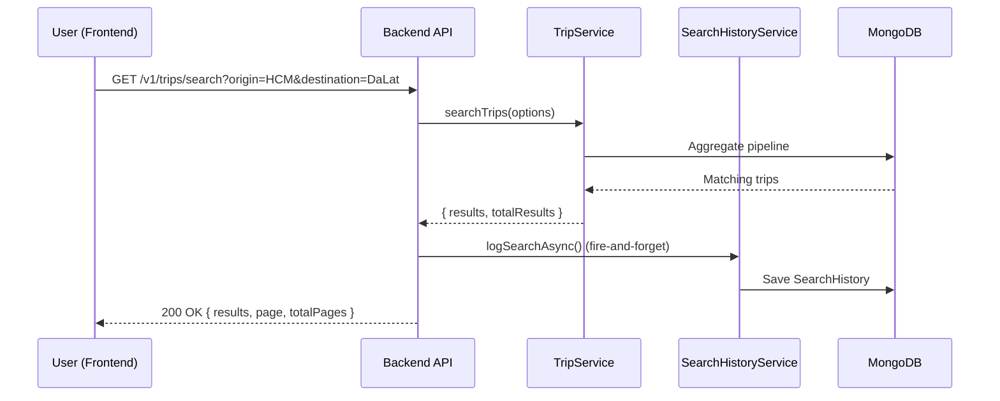
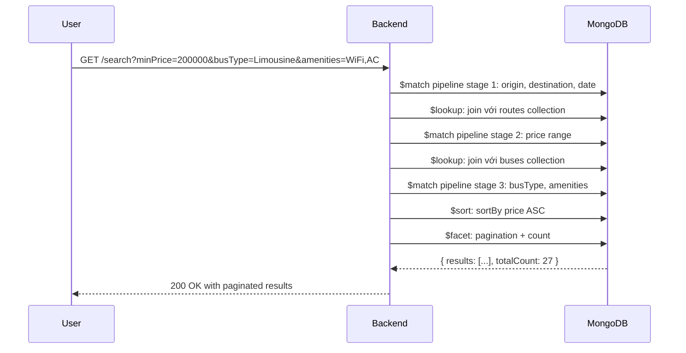

# Search API - Tài Liệu Kỹ Thuật Chi Tiết

## 📋 Tổng Quan

Search API cho phép người dùng tìm kiếm chuyến xe dựa trên nhiều tiêu chí: điểm đi, điểm đến, ngày giờ, giá, loại xe, tiện nghi, v.v. Hệ thống cũng lưu lại lịch sử tìm kiếm để phân tích và gợi ý.

### 🎯 Features

- **Tìm kiếm chuyến xe** với bộ lọc đa dạng
- **Autocomplete** cho địa điểm
- **Popular routes** dựa trên booking statistics
- **Search history tracking** cho analytics
- **Advanced filters**: giá, thời gian, loại xe, tiện nghi

---

## 🏗️ Kiến Trúc

### Files Liên Quan

```
src/
├── routes/v1/
│   ├── trip.route.ts                 # Route: /v1/trips/search
│   └── location.route.ts             # Route: /v1/locations/*
├── controllers/
│   ├── trip.controller.ts            # searchTrips()
│   └── location.controller.ts        # Search locations, popular routes
├── services/
│   ├── trip.service.ts               # searchTrips() - Core logic
│   ├── searchhistory.service.ts     # Log search history
│   └── location.service.ts           # Get locations, popular routes
├── models/
│   ├── trip.model.ts                 # Trip schema
│   ├── route.model.ts                # Route schema
│   └── searchhistory.model.ts        # SearchHistory schema
└── validations/
    ├── trip.validation.ts            # Validate search params
    └── location.validation.ts        # Validate location params
```

---

## 📡 API Endpoints

### 1️⃣ **Search Trips** - Tìm Kiếm Chuyến Xe

**Endpoint:**

```
GET /v1/trips/search
```

**Authentication:** ❌ Public (không cần đăng nhập)

**Query Parameters:**

| Parameter           | Type       | Required | Mô Tả                                                           |
| ------------------- | ---------- | -------- | --------------------------------------------------------------- |
| `origin`            | `string`   | ✅ Yes   | Điểm đi (tên thành phố)                                         |
| `destination`       | `string`   | ✅ Yes   | Điểm đến (tên thành phố)                                        |
| `departureDate`     | `string`   | ✅ Yes   | Ngày khởi hành (ISO format: `2026-01-15`)                       |
| `minPrice`          | `number`   | ❌ No    | Giá tối thiểu (VND)                                             |
| `maxPrice`          | `number`   | ❌ No    | Giá tối đa (VND)                                                |
| `departureTimeFrom` | `string`   | ❌ No    | Thời gian khởi hành từ (`HH:mm`, vd: `08:00`)                   |
| `departureTimeTo`   | `string`   | ❌ No    | Thời gian khởi hành đến (`HH:mm`, vd: `18:00`)                  |
| `busType`           | `string`   | ❌ No    | Loại xe: `Limousine`, `Sleeper`, `Seater`, `Semi-Sleeper`       |
| `amenities`         | `string[]` | ❌ No    | Tiện nghi: `WiFi`, `AC`, `WC`, `TV`, `Water`                    |
| `operatorId`        | `string`   | ❌ No    | ID nhà xe                                                       |
| `minAvailableSeats` | `number`   | ❌ No    | Số ghế trống tối thiểu                                          |
| `status`            | `string`   | ❌ No    | Trạng thái trip: `scheduled`, `in-progress`, `completed`        |
| `sortBy`            | `string`   | ❌ No    | Sắp xếp: `price`, `departureTime`, `duration`, `availableSeats` |
| `sortOrder`         | `string`   | ❌ No    | Thứ tự: `asc`, `desc` (default: `asc`)                          |
| `page`              | `number`   | ❌ No    | Trang số (default: `1`)                                         |
| `limit`             | `number`   | ❌ No    | Số kết quả/trang (default: `10`)                                |

**Example Request:**

```bash
GET /v1/trips/search?origin=Ho%20Chi%20Minh&destination=Da%20Lat&departureDate=2026-01-15&minPrice=200000&maxPrice=500000&busType=Limousine&sortBy=price&sortOrder=asc&page=1&limit=10
```

**Response:**

```json
{
  "results": [
    {
      "_id": "675d1234567890abcdef1234",
      "route": {
        "_id": "675d...",
        "origin": {
          "city": "Ho Chi Minh",
          "province": "Ho Chi Minh"
        },
        "destination": {
          "city": "Da Lat",
          "province": "Lam Dong"
        },
        "distance": 308,
        "duration": 360,
        "basePrice": 250000
      },
      "bus": {
        "_id": "675d...",
        "busNumber": "51B-12345",
        "type": "Limousine",
        "totalSeats": 24,
        "amenities": ["WiFi", "AC", "WC"]
      },
      "departureTime": "2026-01-15T08:00:00.000Z",
      "arrivalTime": "2026-01-15T14:00:00.000Z",
      "price": 280000,
      "availableSeats": 18,
      "bookedSeats": ["A1", "A2"],
      "status": "scheduled"
    }
    // ... more trips
  ],
  "page": 1,
  "limit": 10,
  "totalPages": 3,
  "totalResults": 27
}
```

---

### 2️⃣ **Get All Locations** - Lấy Tất Cả Địa Điểm

**Endpoint:**

```
GET /v1/locations
```

**Authentication:** ❌ Public

**Response:**

```json
{
  "locations": [
    { "city": "Ho Chi Minh", "province": "Ho Chi Minh" },
    { "city": "Da Lat", "province": "Lam Dong" },
    { "city": "Nha Trang", "province": "Khanh Hoa" }
    // ... more locations
  ]
}
```

**Use Case:** Populate dropdown/combobox cho origin và destination

---

### 3️⃣ **Search Locations** - Autocomplete Địa Điểm

**Endpoint:**

```
GET /v1/locations/search
```

**Query Parameters:**

| Parameter | Type     | Required | Mô Tả                           |
| --------- | -------- | -------- | ------------------------------- |
| `q`       | `string` | ✅ Yes   | Search query (min 2 characters) |

**Example Request:**

```bash
GET /v1/locations/search?q=ho
```

**Response:**

```json
{
  "results": [
    { "city": "Ho Chi Minh", "province": "Ho Chi Minh" },
    { "city": "Hoi An", "province": "Quang Nam" }
  ]
}
```

**Use Case:** Autocomplete khi user gõ tên thành phố

---

### 4️⃣ **Popular Locations** - Địa Điểm Phổ Biến

**Endpoint:**

```
GET /v1/locations/popular
```

**Query Parameters:**

| Parameter | Type     | Required | Default |
| --------- | -------- | -------- | ------- |
| `limit`   | `number` | ❌ No    | `10`    |

**Response:**

```json
{
  "popularLocations": [
    {
      "city": "Ho Chi Minh",
      "province": "Ho Chi Minh",
      "searchCount": 1247
    },
    {
      "city": "Da Lat",
      "province": "Lam Dong",
      "searchCount": 892
    }
    // ... more
  ]
}
```

**Use Case:** Hiển thị suggestions cho điểm đi/đến phổ biến

---

### 5️⃣ **Popular Routes** - Tuyến Đường Phổ Biến

**Endpoint:**

```
GET /v1/locations/popular-routes
```

**Query Parameters:**

| Parameter | Type     | Required | Default |
| --------- | -------- | -------- | ------- |
| `limit`   | `number` | ❌ No    | `10`    |

**Response:**

```json
{
  "popularRoutes": [
    {
      "_id": "675d...",
      "origin": {
        "city": "Ho Chi Minh",
        "province": "Ho Chi Minh"
      },
      "destination": {
        "city": "Da Lat",
        "province": "Lam Dong"
      },
      "distance": 308,
      "duration": 360,
      "basePrice": 250000,
      "bookingCount": 342
    }
    // ... more routes
  ]
}
```

**Source:** Dựa trên số lượng bookings thực tế

**Use Case:** Gợi ý tuyến đường phổ biến trên homepage

---

## 🔄 Flow Hoạt Động

### Flow 1: Basic Search



**Key Points:**

- Search history được log **async** (không block response)
- Sử dụng MongoDB aggregation pipeline cho performance
- Populate `route` và `bus` để trả full data

---

### Flow 2: Advanced Search với Filters



---

## 🛠️ Core Implementation

### Search Logic (trip.service.ts)

```typescript
const searchTrips = async (options: SearchTripsOptions): Promise<SearchResult> => {
  const pipeline: PipelineStage[] = [];

  // Stage 1: Match by date range
  if (options.departureDate) {
    const startOfDay = new Date(options.departureDate);
    startOfDay.setHours(0, 0, 0, 0);
    const endOfDay = new Date(options.departureDate);
    endOfDay.setHours(23, 59, 59, 999);

    pipeline.push({
      $match: {
        departureTime: { $gte: startOfDay, $lte: endOfDay },
      },
    });
  }

  // Stage 2: Lookup routes
  pipeline.push({
    $lookup: {
      from: 'routes',
      localField: 'route',
      foreignField: '_id',
      as: 'routeData',
    },
  });

  // Stage 3: Match origin & destination
  if (options.origin || options.destination) {
    const routeMatch: any = {};
    if (options.origin) {
      routeMatch['routeData.origin.city'] = {
        $regex: new RegExp(options.origin, 'i'),
      };
    }
    if (options.destination) {
      routeMatch['routeData.destination.city'] = {
        $regex: new RegExp(options.destination, 'i'),
      };
    }
    pipeline.push({ $match: routeMatch });
  }

  // Stage 4: Price range filter
  if (options.minPrice || options.maxPrice) {
    const priceMatch: any = {};
    if (options.minPrice) priceMatch.$gte = options.minPrice;
    if (options.maxPrice) priceMatch.$lte = options.maxPrice;
    pipeline.push({ $match: { price: priceMatch } });
  }

  // Stage 5: Departure time filter (HH:mm format)
  const timeFilters = buildTimeFilterExpr(options.departureTimeFrom, options.departureTimeTo);
  if (timeFilters.length > 0) {
    pipeline.push({
      $match: {
        $expr: { $and: timeFilters },
      },
    });
  }

  // Stage 6: Lookup buses
  pipeline.push({
    $lookup: {
      from: 'buses',
      localField: 'bus',
      foreignField: '_id',
      as: 'busData',
    },
  });

  // Stage 7: Bus type filter
  if (options.busType) {
    pipeline.push({
      $match: { 'busData.type': options.busType },
    });
  }

  // Stage 8: Amenities filter
  if (options.amenities) {
    const amenitiesArray = Array.isArray(options.amenities) ? options.amenities : [options.amenities];
    pipeline.push({
      $match: {
        'busData.amenities': { $all: amenitiesArray },
      },
    });
  }

  // Stage 9: Available seats filter
  if (options.minAvailableSeats) {
    pipeline.push({
      $match: {
        availableSeats: { $gte: options.minAvailableSeats },
      },
    });
  }

  // Stage 10: Sort
  const sortBy = options.sortBy || 'departureTime';
  const sortOrder = options.sortOrder === 'desc' ? -1 : 1;
  pipeline.push({ $sort: { [sortBy]: sortOrder } });

  // Stage 11: Pagination with $facet
  const page = options.page || 1;
  const limit = options.limit || 10;
  const skip = (page - 1) * limit;

  pipeline.push({
    $facet: {
      metadata: [{ $count: 'totalResults' }],
      results: [{ $skip: skip }, { $limit: limit }],
    },
  });

  const result = await Trip.aggregate(pipeline);

  const totalResults = result[0]?.metadata[0]?.totalResults || 0;
  const results = result[0]?.results || [];

  return {
    results,
    page,
    limit,
    totalPages: Math.ceil(totalResults / limit),
    totalResults,
  };
};
```

**Key Features:**

- ✅ **Flexible filtering** với MongoDB aggregation
- ✅ **Time-based search** (convert HH:mm to minutes)
- ✅ **Pagination** với $facet (1 query để có results + count)
- ✅ **Case-insensitive search** với regex
- ✅ **Amenities filtering** với $all operator

---

### Time Filter Helper

```typescript
// Helper: Convert "08:00" → 480 minutes
const timeToMinutes = (time: string): number => {
  const [hour, minute] = time.split(':').map(Number);
  return hour * 60 + minute;
};

// Build time filter expression
const buildTimeFilterExpr = (from?: string, to?: string): object[] => {
  const expressions: object[] = [];

  // Extract minutes from departureTime
  const minutesExpr = {
    $add: [{ $multiply: [{ $hour: '$departureTime' }, 60] }, { $minute: '$departureTime' }],
  };

  if (from) {
    expressions.push({ $gte: [minutesExpr, timeToMinutes(from)] });
  }
  if (to) {
    expressions.push({ $lte: [minutesExpr, timeToMinutes(to)] });
  }

  return expressions;
};
```

**Example:**

- `departureTimeFrom=08:00` → Match trips from 8:00 AM onwards
- `departureTimeTo=18:00` → Match trips until 6:00 PM

---

## 📊 Search History Tracking

### Purpose

- **Analytics**: Phân tích hành vi tìm kiếm
- **Popular routes**: Xác định tuyến phổ biến
- **Recommendations**: Gợi ý cho user

### Schema (searchhistory.model.ts)

```typescript
{
  userId?: ObjectId,           // Optional (null for guest)
  sessionId?: string,          // Browser session
  originCity: string,          // "Ho Chi Minh"
  destinationCity: string,     // "Da Lat"
  travelDate?: Date,           // "2026-01-15"
  filters: {
    busType?: string[],
    priceRange?: { min: number, max: number },
    departureTimeRange?: { start: string, end: string },
    amenities?: string[]
  },
  resultsCount: number,        // Số kết quả tìm được
  createdAt: Date              // Timestamp
}
```

### Logging Logic

```typescript
// trip.controller.ts
const results = await tripService.searchTrips(options);

// Fire-and-forget logging (async, không block response)
if (origin && destination) {
  searchHistoryService.logSearchAsync({
    userId: req.user?._id?.toString(),
    sessionId: req.headers['x-session-id'] as string,
    originCity: origin,
    destinationCity: destination,
    travelDate: departureDate ? new Date(departureDate) : undefined,
    filters: {
      busType: busType ? [busType] : undefined,
      priceRange: minPrice || maxPrice ? { min: minPrice, max: maxPrice } : undefined,
      departureTimeRange:
        departureTimeFrom || departureTimeTo ? { start: departureTimeFrom, end: departureTimeTo } : undefined,
      amenities: amenities ? [amenities] : undefined,
    },
    resultsCount: results.totalResults,
  });
}

res.send(results);
```

**Key Points:**

- ✅ **Async logging** với `.catch()` để không crash nếu có lỗi
- ✅ Lưu cả **guest searches** (dựa vào `sessionId`)
- ✅ Track **filter usage** để biết user quan tâm gì

---

## 🎯 Popular Routes Algorithm

### Implementation (analytics.service.ts)

```typescript
const getPopularRoutes = async (limit: number) => {
  // Aggregate bookings by route
  const routeCounts: { [routeId: string]: number } = {};

  const bookings = await Booking.find({ status: { $ne: 'cancelled' } })
    .populate('trip')
    .lean();

  bookings.forEach((booking: any) => {
    if (booking.trip?.route) {
      const routeId = booking.trip.route.toString();
      routeCounts[routeId] = (routeCounts[routeId] || 0) + 1;
    }
  });

  // Sort by count descending
  const popularRoutes = Object.entries(routeCounts)
    .sort((a, b) => b[1] - a[1])
    .slice(0, limit)
    .map(([routeId, count]) => ({
      routeId,
      bookingCount: count,
    }));

  // Populate route details
  const routeIds = popularRoutes.map((r) => r.routeId);
  const routes = await Route.find({ _id: { $in: routeIds } });

  return popularRoutes.map((pr) => {
    const route = routes.find((r) => r._id.toString() === pr.routeId);
    return {
      ...route?.toObject(),
      bookingCount: pr.bookingCount,
    };
  });
};
```

**Alternative Approach (location.service.ts):**

```typescript
const getPopularRoutes = async (limit: number = 10) => {
  const popularRoutes = await Route.find({ isActive: true })
    .sort({ bookingCount: -1 }) // Assume Route has bookingCount field
    .limit(limit);

  return popularRoutes.map((route) => ({
    _id: route._id,
    origin: route.origin,
    destination: route.destination,
    distance: route.distance,
    duration: route.duration,
    basePrice: route.basePrice,
    bookingCount: route.bookingCount || 0,
  }));
};
```

---

## 🔍 Autocomplete Implementation

### Locations Search (location.service.ts)

```typescript
const searchLocations = async (query: string) => {
  const routes = await Route.find({
    $or: [
      { 'origin.city': { $regex: new RegExp(query, 'i') } },
      { 'origin.province': { $regex: new RegExp(query, 'i') } },
      { 'destination.city': { $regex: new RegExp(query, 'i') } },
      { 'destination.province': { $regex: new RegExp(query, 'i') } },
    ],
  }).select('origin destination');

  const locations = new Set<string>();

  routes.forEach((route) => {
    locations.add(JSON.stringify(route.origin));
    locations.add(JSON.stringify(route.destination));
  });

  return Array.from(locations).map((loc) => JSON.parse(loc));
};
```

**Optimization:**

- ✅ Use **index** on `origin.city` và `destination.city`
- ✅ Limit results: `.limit(20)`
- ✅ Cache frequent queries với Redis (TODO)

---

## 📈 Performance Optimization

### 1. Database Indexes

```typescript
// trip.model.ts
tripSchema.index({ departureTime: 1, status: 1 });
tripSchema.index({ route: 1 });
tripSchema.index({ price: 1 });
tripSchema.index({ availableSeats: -1 });

// route.model.ts
routeSchema.index({ 'origin.city': 1, 'destination.city': 1 });
routeSchema.index({ bookingCount: -1 });
```

### 2. Aggregation Pipeline Optimization

**Tips:**

- ✅ **Match early**: Đặt `$match` ở đầu pipeline
- ✅ **Project unused fields**: Dùng `$project` để bỏ fields không cần
- ✅ **Limit results**: Dùng `$limit` sớm nếu có thể

**Example:**

```typescript
// ❌ Bad: Lookup trước khi filter
pipeline.push({ $lookup: { ... } });
pipeline.push({ $match: { price: { $lte: 500000 } } });

// ✅ Good: Filter trước khi lookup
pipeline.push({ $match: { price: { $lte: 500000 } } });
pipeline.push({ $lookup: { ... } });
```

### 3. Caching Strategy (TODO)

```typescript
// Pseudo-code
const getCachedSearch = async (cacheKey: string) => {
  const cached = await redis.get(cacheKey);
  if (cached) return JSON.parse(cached);

  const results = await searchTrips(options);
  await redis.setex(cacheKey, 300, JSON.stringify(results)); // Cache 5 mins
  return results;
};
```

---

## 🧪 Testing Examples

### Test 1: Basic Search

```bash
curl -X GET "http://localhost:4000/v1/trips/search?origin=Ho%20Chi%20Minh&destination=Da%20Lat&departureDate=2026-01-15"
```

### Test 2: Advanced Filters

```bash
curl -X GET "http://localhost:4000/v1/trips/search?origin=HCM&destination=DaLat&departureDate=2026-01-15&minPrice=200000&maxPrice=500000&busType=Limousine&amenities=WiFi&amenities=AC&departureTimeFrom=08:00&departureTimeTo=18:00&sortBy=price&sortOrder=asc"
```

### Test 3: Autocomplete

```bash
curl -X GET "http://localhost:4000/v1/locations/search?q=ho"
```

### Test 4: Popular Routes

```bash
curl -X GET "http://localhost:4000/v1/locations/popular-routes?limit=5"
```

---

## ⚠️ Common Issues

### Issue 1: No Results Found

**Causes:**

- Origin/destination không match (case-sensitive issue)
- Không có trips trong ngày đó
- Filters quá strict

**Debug:**

```typescript
console.log('Search params:', { origin, destination, departureDate });
console.log('Pipeline stages:', JSON.stringify(pipeline, null, 2));
```

### Issue 2: Slow Search Response

**Solutions:**

- ✅ Add database indexes
- ✅ Reduce pipeline stages
- ✅ Limit populate fields

### Issue 3: Amenities Filter Not Working

**Fix:**

```typescript
// ❌ Wrong: String comparison
{ 'busData.amenities': amenities }

// ✅ Correct: Array $all operator
{ 'busData.amenities': { $all: amenitiesArray } }
```

---

## 📚 API Reference Summary

| Endpoint                       | Method | Auth  | Purpose                   |
| ------------------------------ | ------ | ----- | ------------------------- |
| `/v1/trips/search`             | GET    | ❌ No | Search trips with filters |
| `/v1/locations`                | GET    | ❌ No | Get all locations         |
| `/v1/locations/search`         | GET    | ❌ No | Autocomplete locations    |
| `/v1/locations/popular`        | GET    | ❌ No | Popular locations         |
| `/v1/locations/popular-routes` | GET    | ❌ No | Popular routes            |

---

## 🎓 Best Practices

### 1. Always Validate Dates

```typescript
// ❌ Bad
const date = new Date(req.query.departureDate);

// ✅ Good
const dateStr = req.query.departureDate as string;
if (!dateStr || isNaN(Date.parse(dateStr))) {
  throw new ApiError(400, 'Invalid departure date');
}
const date = new Date(dateStr);
```

### 2. Handle Empty Results Gracefully

```typescript
if (results.length === 0) {
  return {
    results: [],
    message: 'No trips found. Try adjusting your filters.',
    suggestions: await getPopularRoutes(5),
  };
}
```

### 3. Sanitize Search Inputs

```typescript
// Prevent ReDoS attacks
const sanitizeRegex = (input: string) => {
  return input.replace(/[.*+?^${}()|[\]\\]/g, '\\$&');
};

const safeOrigin = sanitizeRegex(origin);
```

---

## 📞 Support Files

**Tham khảo:**

- [`src/services/trip.service.ts`](../src/services/trip.service.ts) - Core search logic
- [`src/controllers/trip.controller.ts`](../src/controllers/trip.controller.ts) - Controller
- [`src/routes/v1/trip.route.ts`](../src/routes/v1/trip.route.ts) - Routes
- [`src/models/searchhistory.model.ts`](../src/models/searchhistory.model.ts) - Schema

---

**Last Updated:** January 2, 2026
**Version:** 1.0.0
