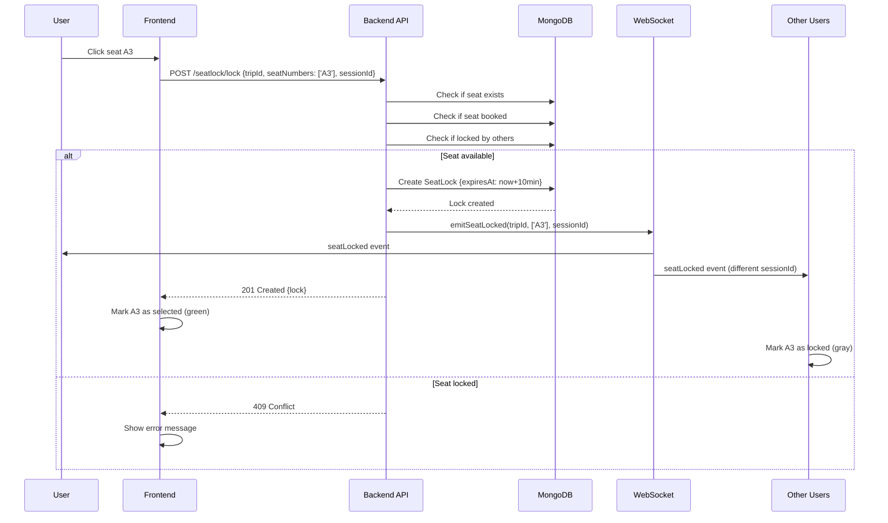
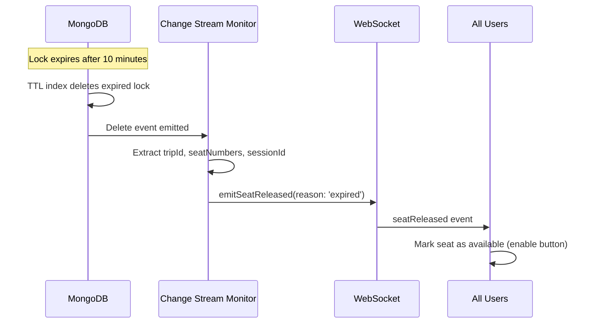
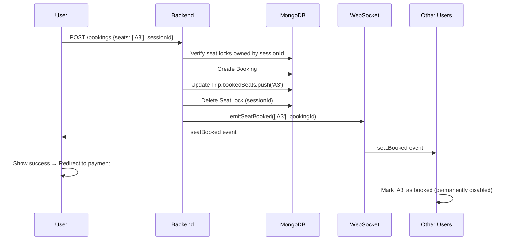

# Seat Map & Seat Locking - Tài Liệu Kỹ Thuật Chi Tiết

## 📋 Tổng Quan

Seat Map API quản lý sơ đồ ghế ngồi, khóa ghế tạm thời, và đồng bộ real-time trạng thái ghế giữa nhiều người dùng để tránh xung đột khi đặt vé.

### 🎯 Features

- **Seat Map Visualization** - Hiển thị sơ đồ ghế theo layout bus
- **Temporary Locking** - Khóa ghế tạm 10 phút khi user chọn
- **Real-time Sync** - WebSocket để sync trạng thái ghế
- **Conflict Prevention** - Ngăn nhiều user chọn cùng 1 ghế
- **Auto-expiry** - Tự động giải phóng ghế sau 10 phút

---

## 🏗️ Kiến Trúc

### Files Liên Quan

```
src/
├── routes/v1/
│   ├── trip.route.ts                # GET /:tripId/seat-map
│   └── seatlock.route.ts            # POST /lock, /release, /extend
├── controllers/
│   ├── trip.controller.ts           # getSeatMap()
│   └── seatlock.controller.ts       # lockSeats(), releaseLocks()
├── services/
│   ├── trip.service.ts              # getSeatMap() logic
│   ├── seatlock.service.ts          # Seat locking logic
│   ├── seatlock-monitor.service.ts  # MongoDB Change Stream monitor
│   └── socket.service.ts            # Emit WebSocket events
└── models/
    ├── trip.model.ts                # Trip with bookedSeats[]
    ├── bus.model.ts                 # Bus với seatMap schema
    └── seatlock.model.ts            # SeatLock with TTL index
```

---

## 📊 Data Models

### Bus Seat Map Schema

```typescript
{
  seatMap: {
    name: string;              // "2x2 Limousine Layout"
    rows: number;              // 6 rows
    columns: number;           // 4 columns (2 left + aisle + 2 right)
    seats: [
      {
        seatNumber: string;    // "A1", "A2", "B1", etc.
        row: number;           // 1, 2, 3...
        column: number;        // 1 (left), 2 (left), 3 (right), 4 (right)
        position: 'window' | 'aisle';
        type: 'normal' | 'vip' | 'sleeper';
        priceModifier: number; // +20000 for VIP, 0 for normal
        isAvailable: boolean;  // Can be disabled (broken seat, etc.)
      }
    ]
  }
}
```

**Example Layout (Limousine 2x2):**

```
Row 1:  [A1] [A2]   [A3] [A4]
Row 2:  [B1] [B2]   [B3] [B4]
Row 3:  [C1] [C2]   [C3] [C4]
Row 4:  [D1] [D2]   [D3] [D4]
Row 5:  [E1] [E2]   [E3] [E4]
Row 6:  [F1] [F2]   [F3] [F4]
```

---

### SeatLock Model

```typescript
{
  trip: ObjectId;              // Reference to Trip
  seatNumbers: string[];       // ["A1", "A2"]
  sessionId: string;           // "guest-123456" or "user-675d..."
  user?: ObjectId;             // If authenticated
  expiresAt: Date;             // Lock expiration (10 minutes)
  metadata?: {
    guestEmail?: string;
    guestPhone?: string;
  }
}
```

**TTL Index:**

```typescript
seatLockSchema.index({ expiresAt: 1 }, { expireAfterSeconds: 0 });
```

- MongoDB tự động xóa documents khi `expiresAt` quá thời gian hiện tại
- Change Stream phát hiện delete → Emit `seatReleased` event

---

## 📡 API Endpoints

### 1️⃣ **Get Seat Map** - Lấy Sơ Đồ Ghế

**Endpoint:**

```
GET /v1/trips/:tripId/seat-map
```

**Authentication:** ❌ Public

**Query Parameters:**

| Parameter   | Type     | Required | Mô Tả                                |
| ----------- | -------- | -------- | ------------------------------------ |
| `sessionId` | `string` | ❌ No    | Session ID để highlight ghế của mình |

**Example Request:**

```bash
GET /v1/trips/675d1234567890abcdef1234/seat-map?sessionId=guest-123456
```

**Response:**

```json
{
  "tripId": "675d1234567890abcdef1234",
  "layout": {
    "rows": 6,
    "columns": 4,
    "name": "2x2 Limousine Layout"
  },
  "seats": [
    {
      "seatNumber": "A1",
      "row": 1,
      "column": 1,
      "position": "window",
      "type": "normal",
      "price": 250000,
      "status": "available",
      "isMyLock": false
    },
    {
      "seatNumber": "A2",
      "row": 1,
      "column": 2,
      "position": "aisle",
      "type": "normal",
      "price": 250000,
      "status": "locked",
      "lockedBy": "guest-789012",
      "expiresAt": "2026-01-02T11:00:00.000Z",
      "isMyLock": false
    },
    {
      "seatNumber": "A3",
      "row": 1,
      "column": 3,
      "position": "aisle",
      "type": "normal",
      "price": 250000,
      "status": "locked",
      "lockedBy": "guest-123456",
      "expiresAt": "2026-01-02T11:05:00.000Z",
      "isMyLock": true
    },
    {
      "seatNumber": "B1",
      "row": 2,
      "column": 1,
      "position": "window",
      "type": "vip",
      "price": 270000,
      "status": "booked",
      "isMyLock": false
    }
    // ... more seats
  ],
  "summary": {
    "totalSeats": 24,
    "availableSeats": 15,
    "bookedSeats": 6,
    "lockedSeats": 3,
    "myLockedSeats": ["A3"]
  }
}
```

**Status Values:**

- `available` - Ghế có thể chọn
- `locked` - Đang được user khác giữ (10 phút)
- `booked` - Đã được đặt (không thể chọn)

---

### 2️⃣ **Lock Seats** - Khóa Ghế Tạm Thời

**Endpoint:**

```
POST /v1/seatlock/lock
```

**Authentication:** ❌ Public (có thể dùng cho guest)

**Request Body:**

```json
{
  "tripId": "675d1234567890abcdef1234",
  "seatNumbers": ["A3", "A4"],
  "sessionId": "guest-123456",
  "metadata": {
    "guestEmail": "user@example.com",
    "guestPhone": "+84901234567"
  }
}
```

**Validation:**

- ✅ Trip exists
- ✅ Seats exist in bus seat map
- ✅ Seats not already booked
- ✅ Seats not locked by others
- ✅ Enough capacity available

**Response (Success):**

```json
{
  "success": true,
  "message": "Seats locked successfully",
  "data": {
    "_id": "675d...",
    "trip": "675d1234567890abcdef1234",
    "seatNumbers": ["A3", "A4"],
    "sessionId": "guest-123456",
    "expiresAt": "2026-01-02T11:05:00.000Z"
  },
  "sessionId": "guest-123456"
}
```

**Response (Conflict):**

```json
{
  "success": false,
  "statusCode": 409,
  "message": "Seats A3 are already locked by another user"
}
```

**WebSocket Event Emitted:**

```javascript
// To all users in trip room
socket.emit('seatLocked', {
  tripId: '675d...',
  seatNumbers: ['A3', 'A4'],
  sessionId: 'guest-123456',
  expiresAt: '2026-01-02T11:05:00.000Z',
  lockedBy: 'guest',
  timestamp: '2026-01-02T10:55:00.000Z',
});
```

---

### 3️⃣ **Release Locks** - Giải Phóng Ghế

**Endpoint:**

```
POST /v1/seatlock/release
```

**Request Body:**

```json
{
  "sessionId": "guest-123456"
}
```

**Response:**

```json
{
  "success": true,
  "message": "2 seat lock(s) released",
  "data": {
    "releasedCount": 2
  }
}
```

**Use Cases:**

- User rời trang chọn ghế
- User hủy chọn ghế
- Component unmount

**WebSocket Event Emitted:**

```javascript
socket.emit('seatReleased', {
  tripId: '675d...',
  seatNumbers: ['A3', 'A4'],
  sessionId: 'guest-123456',
  reason: 'manual',
  timestamp: '2026-01-02T10:57:00.000Z',
});
```

---

### 4️⃣ **Extend Lock** - Gia Hạn Khóa Ghế

**Endpoint:**

```
POST /v1/seatlock/extend
```

**Request Body:**

```json
{
  "sessionId": "guest-123456",
  "minutes": 5
}
```

**Response:**

```json
{
  "success": true,
  "message": "Locks extended by 5 minutes",
  "data": {
    "extendedCount": 2,
    "newExpiresAt": "2026-01-02T11:10:00.000Z"
  }
}
```

**Use Case:** User cần thêm thời gian để hoàn tất booking

---

### 5️⃣ **Check Availability** - Kiểm Tra Ghế Có Sẵn

**Endpoint:**

```
POST /v1/seatlock/check-availability
```

**Request Body:**

```json
{
  "tripId": "675d1234567890abcdef1234",
  "seatNumbers": ["A3", "A4"]
}
```

**Response:**

```json
{
  "tripId": "675d...",
  "availableSeats": ["A3"],
  "unavailableSeats": [
    {
      "seatNumber": "A4",
      "status": "locked",
      "reason": "Locked by another user",
      "expiresAt": "2026-01-02T11:00:00.000Z"
    }
  ]
}
```

---

### 6️⃣ **Get Locked Seats for Trip**

**Endpoint:**

```
GET /v1/seatlock/:tripId
```

**Response:**

```json
{
  "success": true,
  "data": {
    "tripId": "675d...",
    "lockedSeats": [
      {
        "seatNumbers": ["A2"],
        "sessionId": "guest-789012",
        "expiresAt": "2026-01-02T11:00:00.000Z"
      },
      {
        "seatNumbers": ["A3", "A4"],
        "sessionId": "guest-123456",
        "expiresAt": "2026-01-02T11:05:00.000Z"
      }
    ],
    "count": 2
  }
}
```

---

## 🔄 Flow Hoạt Động

### Flow 1: User Chọn Ghế



---

### Flow 2: Lock Tự Động Hết Hạn



**MongoDB Change Stream:**

```typescript
// seatlock-monitor.service.ts
const changeStream = SeatLock.watch([], {
  fullDocumentBeforeChange: 'whenAvailable',
});

changeStream.on('change', (change) => {
  if (change.operationType === 'delete') {
    const doc = change.fullDocumentBeforeDelete;
    emitSeatReleased(doc.trip, doc.seatNumbers, doc.sessionId, 'expired');
  }
});
```

---

### Flow 3: User Booking Thành Công



---

## 🛠️ Implementation Details

### Lock Seats Service Logic

```typescript
const lockSeats = async (
  tripId: mongoose.Types.ObjectId,
  seatNumbers: string[],
  sessionId: string,
  userId?: mongoose.Types.ObjectId,
  metadata?: any
): Promise<ISeatLock> => {
  // Step 1: Verify trip exists and get bus info
  const trip = await Trip.findById(tripId).populate('bus');
  if (!trip) {
    throw new ApiError(404, 'Trip not found');
  }

  // Step 2: Calculate available capacity
  const bus = trip.bus as any;
  const totalSeats = bus.totalSeats;
  const bookedSeatsCount = trip.bookedSeats.length;

  const allLocks = await SeatLock.find({
    trip: tripId,
    expiresAt: { $gt: new Date() },
  });

  const lockedCount = new Set(allLocks.flatMap((lock) => lock.seatNumbers)).size;

  const available = totalSeats - bookedSeatsCount - lockedCount;

  if (available < seatNumbers.length) {
    throw new ApiError(400, `Not enough seats. Available: ${available}, Requested: ${seatNumbers.length}`);
  }

  // Step 3: Check conflicts with other users
  const conflicts = await SeatLock.find({
    trip: tripId,
    seatNumbers: { $in: seatNumbers },
    expiresAt: { $gt: new Date() },
    sessionId: { $ne: sessionId },
  });

  if (conflicts.length > 0) {
    const conflictSeats = conflicts.flatMap((l) => l.seatNumbers);
    throw new ApiError(409, `Seats ${conflictSeats.join(', ')} already locked by another user`);
  }

  // Step 4: Check if seats are booked
  const bookedSeats = seatNumbers.filter((seat) => trip.bookedSeats.includes(seat));
  if (bookedSeats.length > 0) {
    throw new ApiError(400, `Seats ${bookedSeats.join(', ')} are already booked`);
  }

  // Step 5: Set expiration (10 minutes)
  const expiresAt = new Date(Date.now() + 10 * 60 * 1000);

  // Step 6: Check if session has existing lock
  const existingLock = await SeatLock.findOne({
    trip: tripId,
    sessionId,
    expiresAt: { $gt: new Date() },
  });

  if (existingLock) {
    // Combine seats and extend expiration
    const combinedSeats = [...new Set([...existingLock.seatNumbers, ...seatNumbers])];

    existingLock.seatNumbers = combinedSeats;
    existingLock.expiresAt = expiresAt;
    if (metadata) {
      existingLock.metadata = { ...existingLock.metadata, ...metadata };
    }

    await existingLock.save();

    // Emit WebSocket event for NEW seats only
    emitSeatLocked(tripId, seatNumbers, sessionId, expiresAt, userId);

    return existingLock;
  }

  // Step 7: Create new lock
  const lock = await SeatLock.create({
    trip: tripId,
    seatNumbers,
    sessionId,
    user: userId,
    expiresAt,
    metadata,
  });

  // Step 8: Emit WebSocket event
  emitSeatLocked(tripId, seatNumbers, sessionId, expiresAt, userId);

  return lock;
};
```

---

### Get Seat Map with Real-time Status

```typescript
const getSeatMap = async (tripId: mongoose.Types.ObjectId, sessionId?: string) => {
  const trip = await Trip.findById(tripId).populate({
    path: 'bus',
    select: 'busNumber busType totalSeats seatMap',
  });

  if (!trip) {
    throw new ApiError(404, 'Trip not found');
  }

  const bus = trip.bus as any;
  if (!bus?.seatMap?.seats) {
    throw new ApiError(404, 'Seat map not available for this trip');
  }

  // Get all active locks for this trip
  const locks = await SeatLock.find({
    trip: tripId,
    expiresAt: { $gt: new Date() },
  });

  // Map locks by seat number
  const lockMap = new Map<string, any>();
  locks.forEach((lock) => {
    lock.seatNumbers.forEach((seatNumber) => {
      lockMap.set(seatNumber, {
        sessionId: lock.sessionId,
        expiresAt: lock.expiresAt,
      });
    });
  });

  const allLockedSeats = locks.flatMap((l) => l.seatNumbers);

  // Build seat map with status
  const seats = bus.seatMap.seats.map((seat: any) => {
    const isBooked = trip.bookedSeats?.includes(seat.seatNumber);
    const isLocked = allLockedSeats.includes(seat.seatNumber);
    const lockInfo = lockMap.get(seat.seatNumber);

    // Determine status
    let status: 'available' | 'locked' | 'booked';
    if (isBooked) status = 'booked';
    else if (isLocked) status = 'locked';
    else status = 'available';

    // Get price
    let price = trip.pricePerSeat;
    if (trip.seatPricing instanceof Map) {
      price = trip.seatPricing.get(seat.seatNumber) || trip.pricePerSeat;
    }
    price += seat.priceModifier || 0;

    return {
      seatNumber: seat.seatNumber,
      row: seat.row,
      column: seat.column,
      position: seat.position,
      type: seat.type,
      price: Math.round(price),
      status,
      lockedBy: isLocked ? lockInfo?.sessionId : undefined,
      expiresAt: isLocked ? lockInfo?.expiresAt : undefined,
      isMyLock: isLocked && lockInfo?.sessionId === sessionId,
    };
  });

  // Calculate summary
  const myLockedSeats = seats.filter((s) => s.isMyLock).map((s) => s.seatNumber);

  return {
    tripId: trip._id,
    layout: {
      rows: bus.seatMap.rows,
      columns: bus.seatMap.columns,
      name: bus.seatMap.name,
    },
    seats,
    summary: {
      totalSeats: bus.totalSeats,
      availableSeats: seats.filter((s) => s.status === 'available').length,
      bookedSeats: seats.filter((s) => s.status === 'booked').length,
      lockedSeats: seats.filter((s) => s.status === 'locked').length,
      myLockedSeats,
    },
  };
};
```

---

## 🎨 Frontend Integration

### React Component Example

```typescript
const SeatMap = ({ tripId }) => {
  const [seats, setSeats] = useState([]);
  const [selectedSeats, setSelectedSeats] = useState<string[]>([]);
  const sessionId = useSessionId(); // Custom hook
  const socket = useSocket();

  // Fetch seat map
  useEffect(() => {
    fetch(`/api/v1/trips/${tripId}/seat-map?sessionId=${sessionId}`)
      .then(res => res.json())
      .then(data => setSeats(data.seats));
  }, [tripId, sessionId]);

  // Listen for WebSocket events
  useEffect(() => {
    socket.on('seatLocked', (data) => {
      if (data.sessionId !== sessionId) {
        // Other user locked seats
        setSeats(prevSeats =>
          prevSeats.map(seat =>
            data.seatNumbers.includes(seat.seatNumber)
              ? { ...seat, status: 'locked', lockedBy: data.sessionId }
              : seat
          )
        );
      }
    });

    socket.on('seatReleased', (data) => {
      setSeats(prevSeats =>
        prevSeats.map(seat =>
          data.seatNumbers.includes(seat.seatNumber)
            ? { ...seat, status: 'available', lockedBy: undefined }
            : seat
        )
      );
    });

    socket.on('seatBooked', (data) => {
      setSeats(prevSeats =>
        prevSeats.map(seat =>
          data.seatNumbers.includes(seat.seatNumber)
            ? { ...seat, status: 'booked' }
            : seat
        )
      );
    });

    return () => {
      socket.off('seatLocked');
      socket.off('seatReleased');
      socket.off('seatBooked');
    };
  }, [socket, sessionId]);

  // Handle seat click
  const handleSeatClick = async (seatNumber: string) => {
    const seat = seats.find(s => s.seatNumber === seatNumber);

    if (seat.status !== 'available' && !seat.isMyLock) {
      alert('Seat not available');
      return;
    }

    if (seat.isMyLock) {
      // Deselect
      setSelectedSeats(prev => prev.filter(s => s !== seatNumber));
      // TODO: Call API to release
    } else {
      // Select
      try {
        await fetch('/api/v1/seatlock/lock', {
          method: 'POST',
          body: JSON.stringify({
            tripId,
            seatNumbers: [seatNumber],
            sessionId
          })
        });
        setSelectedSeats(prev => [...prev, seatNumber]);
      } catch (error) {
        alert('Failed to lock seat');
      }
    }
  };

  return (
    <div className="seat-map">
      {seats.map(seat => (
        <SeatButton
          key={seat.seatNumber}
          seat={seat}
          onClick={() => handleSeatClick(seat.seatNumber)}
          isSelected={selectedSeats.includes(seat.seatNumber)}
        />
      ))}
    </div>
  );
};
```

---

## 🧪 Testing Examples

### Test 1: Lock Seats

```bash
curl -X POST "http://localhost:4000/v1/seatlock/lock" \
  -H "Content-Type: application/json" \
  -d '{
    "tripId": "675d1234567890abcdef1234",
    "seatNumbers": ["A3", "A4"],
    "sessionId": "guest-test123"
  }'
```

### Test 2: Get Seat Map

```bash
curl -X GET "http://localhost:4000/v1/trips/675d.../seat-map?sessionId=guest-test123"
```

### Test 3: Release Locks

```bash
curl -X POST "http://localhost:4000/v1/seatlock/release" \
  -H "Content-Type: application/json" \
  -d '{
    "sessionId": "guest-test123"
  }'
```

---

## ⚠️ Common Issues

### Issue 1: Locks Not Expiring

**Cause:** MongoDB Change Stream không hoạt động (cần Replica Set)

**Fix:** Sử dụng MongoDB Atlas hoặc setup local replica set

### Issue 2: Race Condition khi Lock

**Solution:** Atomic operations với unique index

```typescript
seatLockSchema.index({ trip: 1, seatNumbers: 1, sessionId: 1 }, { unique: false });
```

### Issue 3: User Lock Quá Nhiều Ghế

**Solution:** Add validation

```typescript
if (seatNumbers.length > 5) {
  throw new ApiError(400, 'Cannot lock more than 5 seats at once');
}
```

---

## 📚 API Reference Summary

| Endpoint                          | Method | Auth  | Purpose                            |
| --------------------------------- | ------ | ----- | ---------------------------------- |
| `/v1/trips/:tripId/seat-map`      | GET    | ❌ No | Get seat map with real-time status |
| `/v1/seatlock/lock`               | POST   | ❌ No | Lock seats temporarily             |
| `/v1/seatlock/release`            | POST   | ❌ No | Release locked seats               |
| `/v1/seatlock/extend`             | POST   | ❌ No | Extend lock duration               |
| `/v1/seatlock/check-availability` | POST   | ❌ No | Check seat availability            |
| `/v1/seatlock/:tripId`            | GET    | ❌ No | Get all locked seats for trip      |

---

## 📞 Support Files

**Tham khảo:**

- [`src/services/seatlock.service.ts`](../src/services/seatlock.service.ts) - Core locking logic
- [`src/services/trip.service.ts`](../src/services/trip.service.ts) - Seat map generation
- [`src/services/seatlock-monitor.service.ts`](../src/services/seatlock-monitor.service.ts) - Change Stream monitor
- [`docs/SEAT_SELECTION_API.md`](./SEAT_SELECTION_API.md) - API guide
- [`docs/WEBSOCKET-TECHNICAL-DOCS.md`](./WEBSOCKET-TECHNICAL-DOCS.md) - WebSocket integration

---

**Last Updated:** January 2, 2026
**Version:** 1.0.0
